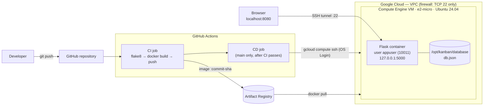

# Kanban Board — End-to-End DevOps on Google Cloud

[](https://github.com/rachelikaminer/devops-final-project/actions/workflows/cicd.yml)

A Flask Kanban task board shipped the way production software is shipped: **containerized**, running on **infrastructure defined as code**, and deployed by a **fully automated CI/CD pipeline**. The app is **not exposed to the internet**. The only way in is an encrypted SSH tunnel.

> Final project — *DevOps & Platform Engineering* course, Gur Seminary, Computer Science track.

---

## Highlights

- **One `git push` to `main` = a verified production deploy.** Lint, build, push, deploy, and a post-deploy health check, with no manual steps.
- **Zero long-lived secrets.** GitHub Actions authenticates to GCP with **Workload Identity Federation** (OIDC). There are no service-account key files to leak or rotate.
- **Minimal attack surface.** The firewall allows **TCP 22 only**, and the app binds to `127.0.0.1` on the VM. Even a firewall mistake would not expose it.
- **Hardened container.** Multi-stage build, **non-root** user (UID 10011), built-in `HEALTHCHECK`.
- **Data survives deploys.** `db.json` lives on a host-mounted volume, so containers are disposable and the data stays.
- **Least privilege everywhere.** Each identity (VM, CI/CD) has only the roles it needs, scoped to a single repository where possible.
- **Full traceability.** Every image is tagged with the Git commit SHA it was built from.

---

## Architecture



**Request path:** Browser → `localhost:8080` → SSH tunnel (port 22, encrypted) → VM `127.0.0.1:5000` → Flask container → `/app/database/db.json` (host volume).

---

## Tech Stack

| Layer | Technology |
|---|---|
| Application | Python 3.12, Flask 3, vanilla JS (RTL Hebrew UI) |
| Storage | JSON file with atomic writes and a thread lock |
| Containerization | Docker (multi-stage, BuildKit secrets) |
| Infrastructure as Code | Terraform 1.5+, Google provider 6.x |
| Cloud | GCP: Compute Engine, VPC, Artifact Registry, IAM, Workload Identity Federation |
| CI/CD | GitHub Actions |
| Quality | flake8 |
| Access | SSH with OS Login, local port forwarding |

---

## Repository Structure

```
.
├── app.py                       # Flask app: REST API + health endpoint
├── templates/index.html         # Kanban UI (todo / in progress / done)
├── requirements.txt
├── Dockerfile                   # Multi-stage, non-root, healthcheck
├── .dockerignore
├── .flake8
├── .github/workflows/cicd.yml   # CI (lint, build, push) + CD (deploy)
├── terraform/
│   ├── main.tf                  # Network, firewall, registry, VM, IAM, WIF
│   ├── variables.tf
│   ├── outputs.tf               # Values for GitHub secrets + tunnel command
│   ├── startup.sh               # VM bootstrap: Docker, registry auth, volume dir
│   └── terraform.tfvars.example
└── scripts/
    └── export-netfree-certs.sh  # Local-only: trust a TLS-inspecting proxy
```

---

## The Application

| Method | Endpoint | Description |
|---|---|---|
| `GET` | `/` | Kanban board UI |
| `GET` | `/health` | Liveness check (`{"status": "ok"}`) |
| `GET` | `/api/tasks` | List all tasks |
| `POST` | `/api/tasks` | Create a task: `{"title": "..."}` |
| `PATCH` | `/api/tasks/<id>` | Move a task: `{"status": "todo" \| "in_progress" \| "done"}` |
| `DELETE` | `/api/tasks/<id>` | Delete a task |

The database path is configurable through `DB_PATH`. Writes go to a temp file and are then atomically renamed, so a crash never leaves a half-written `db.json`.

---

## Container Design

| Decision | Why |
|---|---|
| **Multi-stage build** | Dependencies are installed into `/opt/venv` in a builder stage. Only the venv and the app code are copied to the runtime image. |
| **venv in `/opt`, not `/root/.local`** | A non-root user cannot read `/root`. Installing there would break the app at runtime with `ModuleNotFoundError`. |
| **Non-root `appuser` (UID 10011)** | Limits the blast radius of an application-level compromise. |
| **`HEALTHCHECK` on `/health`** | Docker reports the container as `healthy` or `unhealthy`, not just "running". |
| **Optional `extra_ca` build secret** | Allows local builds behind a TLS-inspecting proxy. The certificate is **never stored in the image**, and CI builds skip it automatically. |

---

## Infrastructure (Terraform)

`terraform apply` creates **20 resources**:

| Group | Resources |
|---|---|
| APIs | Compute, Artifact Registry, IAM, IAM Credentials, STS |
| Network | Custom VPC, subnet `10.10.0.0/24`, firewall `allow-ssh-only` (TCP 22) |
| Registry | Docker repository `kanban-repo` |
| Compute | `e2-micro` Ubuntu 24.04 VM with OS Login enabled and a bootstrap script |
| Identity — VM | Service account with `artifactregistry.reader` on the repository only |
| Identity — CI/CD | `github-deployer` service account, Workload Identity pool + OIDC provider restricted to this repository, `artifactregistry.writer`, `compute.osAdminLogin`, `compute.viewer`, `iam.serviceAccountUser` on the VM identity |

### Why Workload Identity Federation?

The classic approach is to download a service-account JSON key and store it as a GitHub secret. That key is valid until it is manually revoked, and anyone who obtains it can use it.

With WIF, GitHub issues the workflow a short-lived OIDC token. GCP verifies the token and exchanges it for credentials **valid for one hour**. An `attribute_condition` ensures that only workflows from `rachelikaminer/devops-final-project` are accepted. **There is no key to steal.**

---

## CI/CD Pipeline

Defined in [`.github/workflows/cicd.yml`](.github/workflows/cicd.yml).

| Job | Runs on | Steps |
|---|---|---|
| **CI** | Every push and pull request | Checkout → flake8 → authenticate (WIF) → `docker build` → push `:<sha>` and `:latest` to Artifact Registry |
| **CD** | Push to `main` only, after CI succeeds (`needs: ci`) | Authenticate (WIF) → `gcloud compute ssh` → `docker pull :<sha>` → replace container (`--restart unless-stopped`, volume mounted) → **smoke test** `/health` with retries. On failure, prints the container logs and fails the job. |

Branch workflow: each change is developed on its own branch, where CI runs and CD is skipped. It is fast-forward merged into `main` once green, which triggers the deploy.

---

## Getting Started

### Prerequisites
Git, Docker, Terraform ≥ 1.5, Google Cloud CLI, and a GCP project with billing enabled.

### 1. Run locally (Python)
```bash
pip install -r requirements.txt
python app.py              # http://localhost:5000
flake8 .
```

### 2. Run locally (Docker, with a persistent volume)
```bash
docker build -t kanban-app:local .
docker run -d --name kanban -p 127.0.0.1:5000:5000 \
  -v kanban-data:/app/database kanban-app:local
```
Persistence check: add a task, run `docker rm -f kanban`, run the container again, and the task is still there.

> **Behind a TLS-inspecting proxy?** Run `bash scripts/export-netfree-certs.sh`, then build with
> `docker build --secret id=extra_ca,src=certs/netfree-ca.pem -t kanban-app:local .`

### 3. Provision the infrastructure
```bash
gcloud auth login
gcloud auth application-default login
cd terraform
cp terraform.tfvars.example terraform.tfvars   # set project_id and github_repo
terraform init
terraform plan
terraform apply
```

### 4. Configure GitHub secrets
In **Settings → Secrets and variables → Actions**, add these values from `terraform output`:

| Secret | Value |
|---|---|
| `GCP_PROJECT_ID` | Your project ID |
| `GCP_SERVICE_ACCOUNT` | `deployer_service_account` output |
| `GCP_WORKLOAD_IDENTITY_PROVIDER` | `workload_identity_provider` output |

### 5. Deploy
```bash
git push origin main
```
Then follow the run in the **Actions** tab.

### 6. Open the app through the SSH tunnel
```bash
gcloud compute ssh kanban-vm --zone us-central1-a -- -L 8080:localhost:5000
```
Then browse to **http://localhost:8080**. Traffic is forwarded from local port 8080, through the encrypted SSH session, to port 5000 on the VM. Port 5000 is never reachable from the internet.

---

## End-to-End Verification

| # | Check | How |
|---|---|---|
| A | Pipeline is green | Actions tab: flake8, build, push and deploy all pass, and the CD log ends with `{"status":"ok"}` |
| B | Tunnel works | `http://localhost:8080` loads the board |
| C | Data persists across deploys | Add tasks → push a new commit to `main` → after redeploy, the tasks are still there |

---

## Security Summary

- Only **TCP 22** is open. The app listens on `127.0.0.1` on the host, giving defense in depth.
- **OS Login**: SSH access is governed by IAM, with no hand-managed keys on the VM.
- **No static credentials** in GitHub or in the repository (WIF).
- **Least-privilege** service accounts, scoped to the registry repository where possible.
- **Non-root** container user.
- `.gitignore` / `.dockerignore` keep `terraform.tfstate`, `*.tfvars`, local certificates and data out of Git and out of the image.

---

## Lessons Learned

Development was done behind **NetFree**, a filtering proxy that inspects TLS traffic. This surfaced several real-world issues that are common in corporate networks:

| Symptom | Root cause | Solution |
|---|---|---|
| `pip` in `docker build` failed with `CERTIFICATE_VERIFY_FAILED` | Containers do not trust the proxy's CA | Pass the CA as a **BuildKit secret**, so it is used only during the build and never baked into the image |
| Verification still failed with the root CA | The proxy also sends an intermediate that chains to an untrusted root | Export only the intermediates signed by the proxy's trusted roots |
| `gcloud` install and commands failed TLS | gcloud ships its own Python and CA bundle | Point `REQUESTS_CA_BUNDLE` at a combined bundle |
| Outbound SSH (port 22) blocked | Proxy policy | Deployment runs from GitHub-hosted runners, so the pipeline is unaffected |

---

## Cleanup

To avoid charges once you are done:
```bash
cd terraform
terraform destroy
```

---

## Author

**[rachelikaminer](https://github.com/rachelikaminer)**
